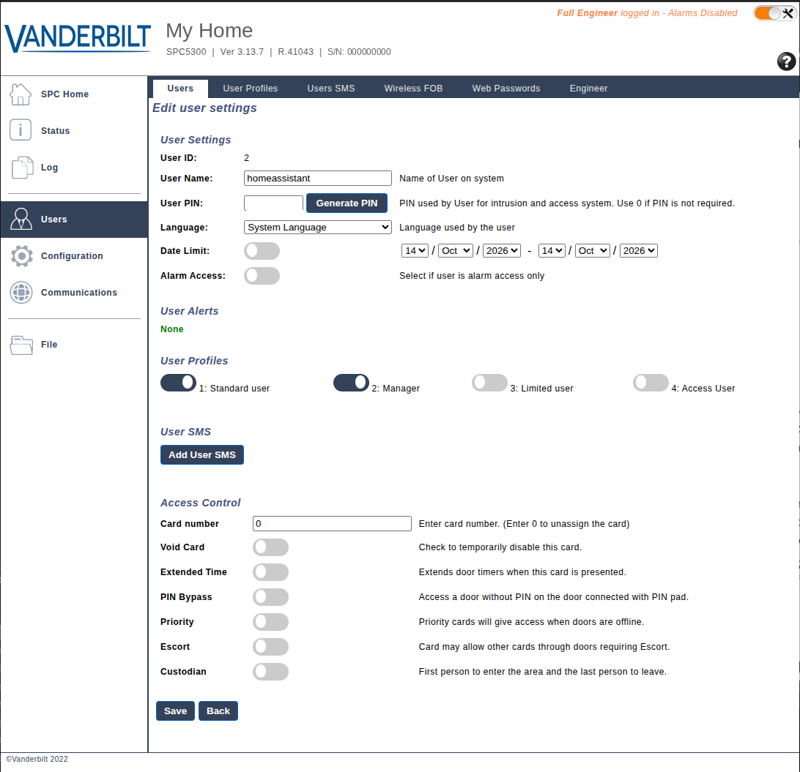
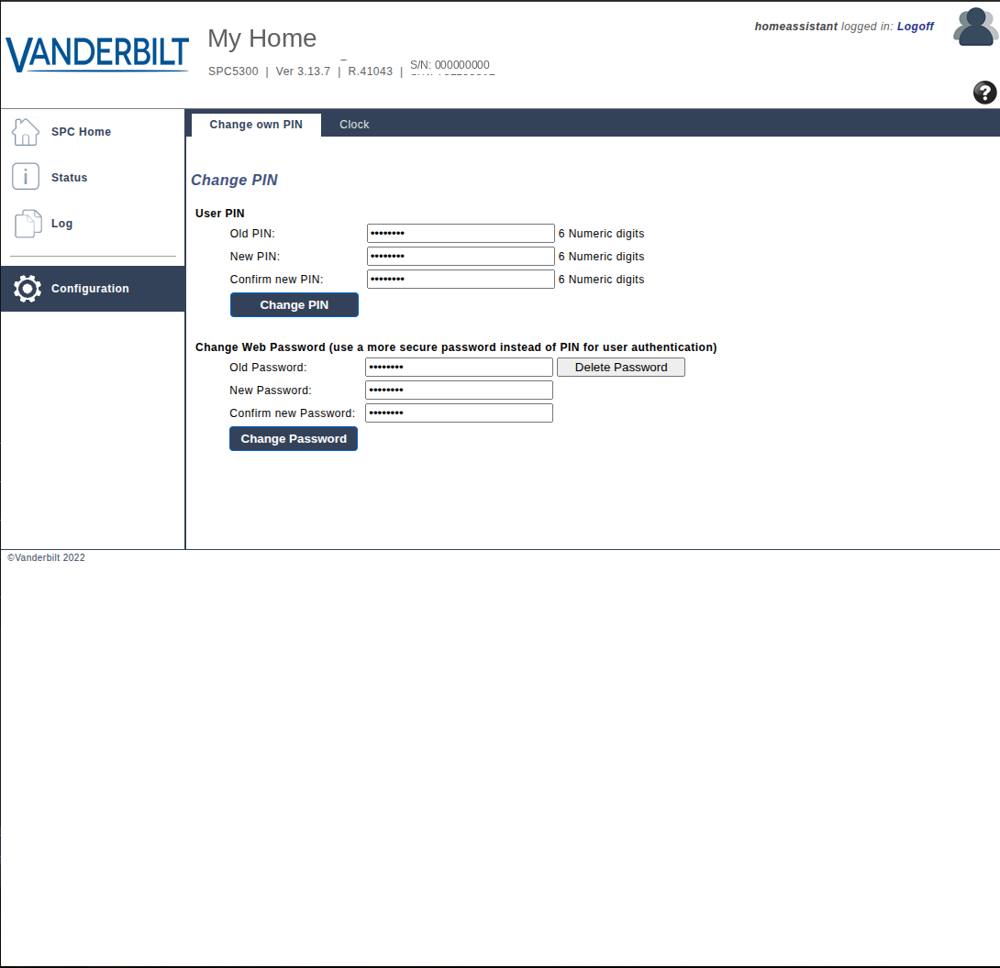
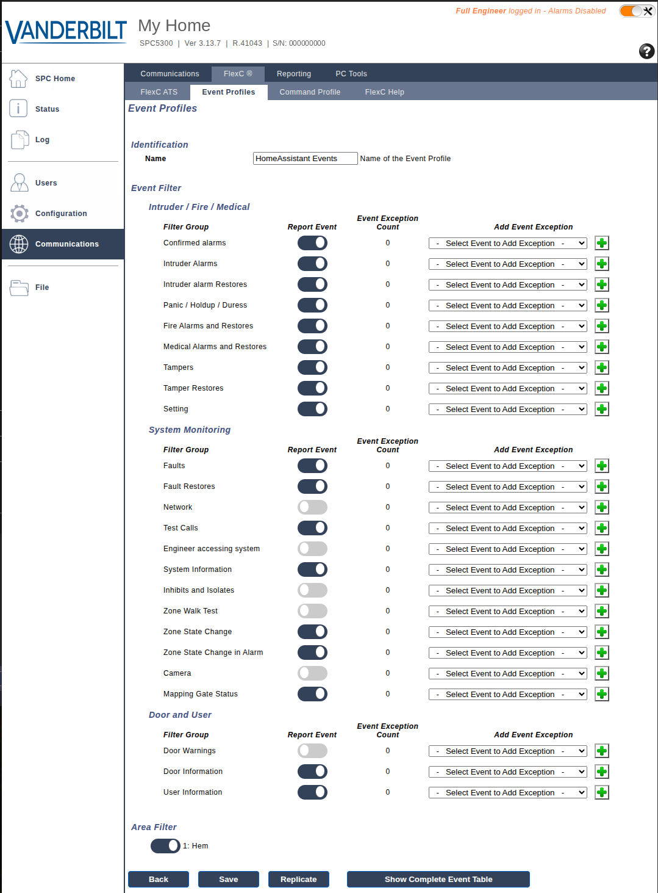
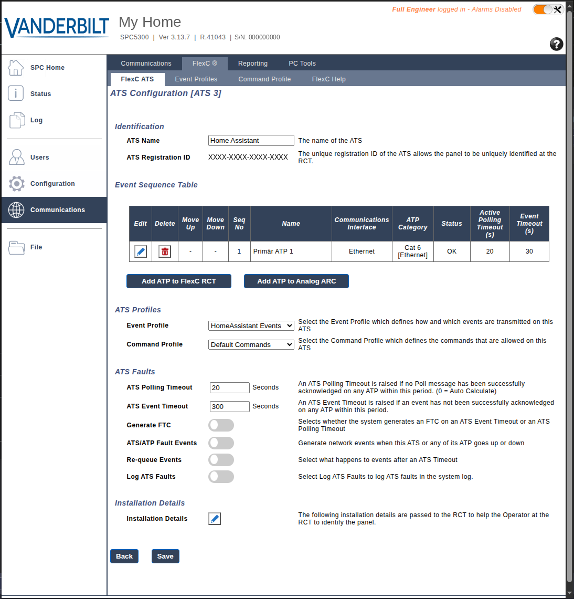
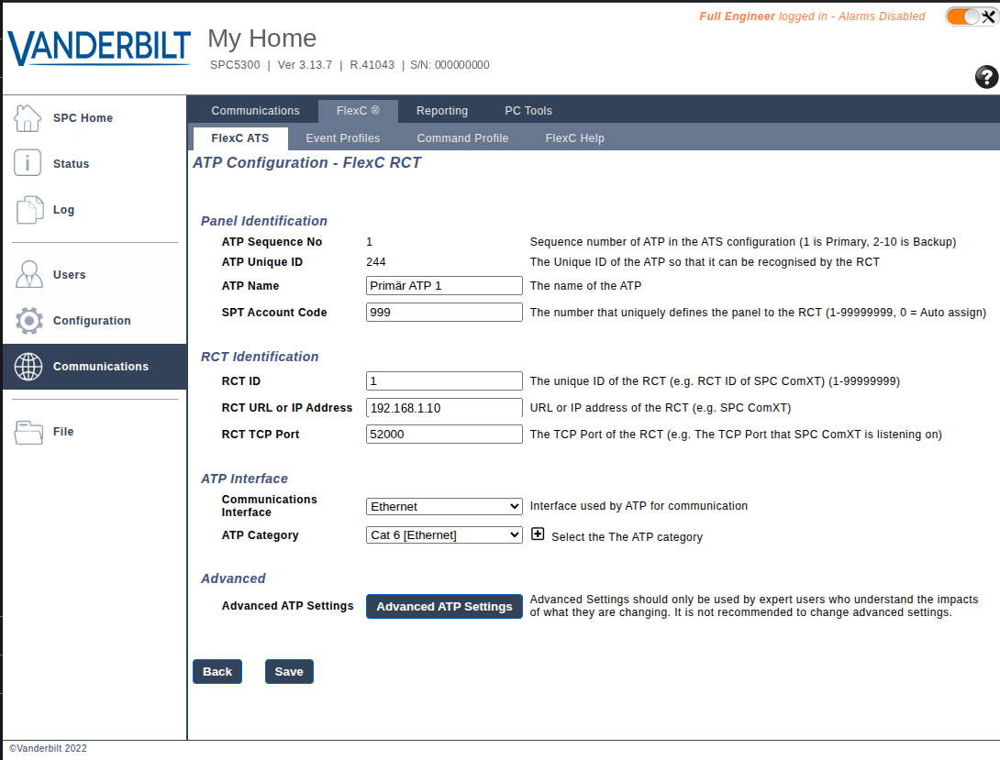
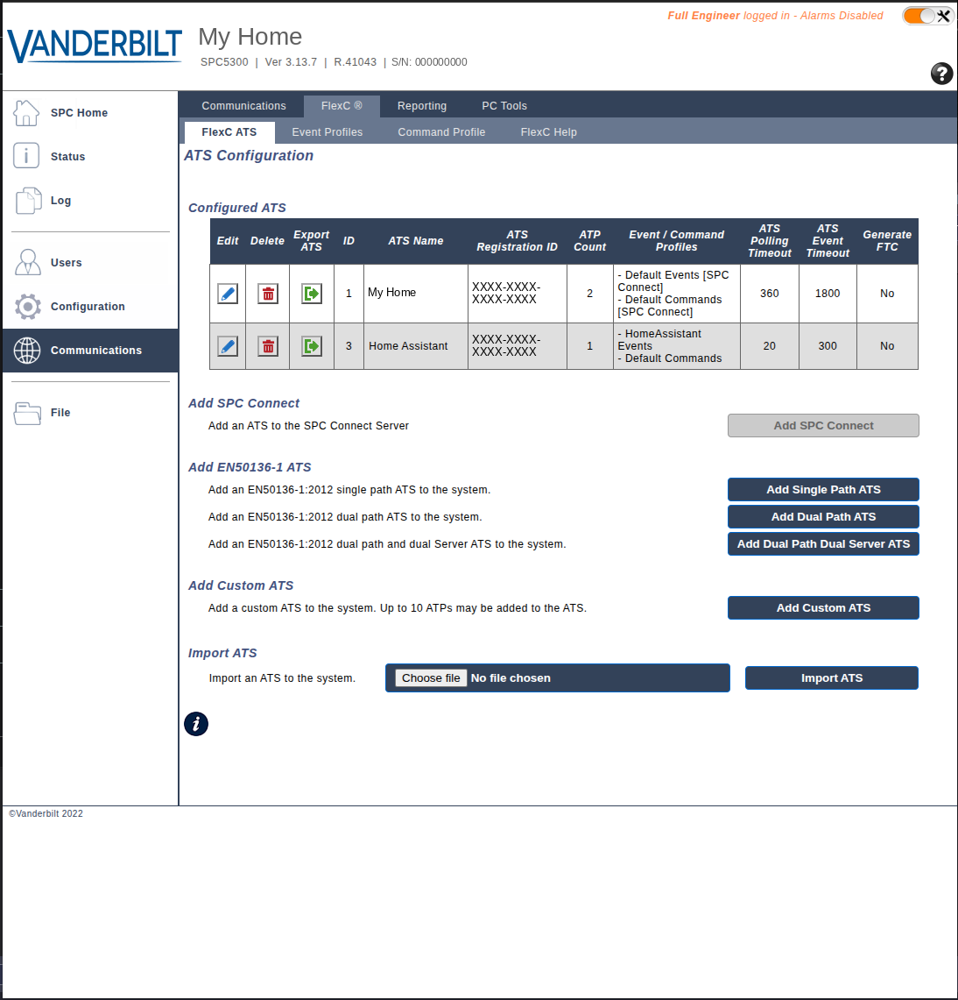
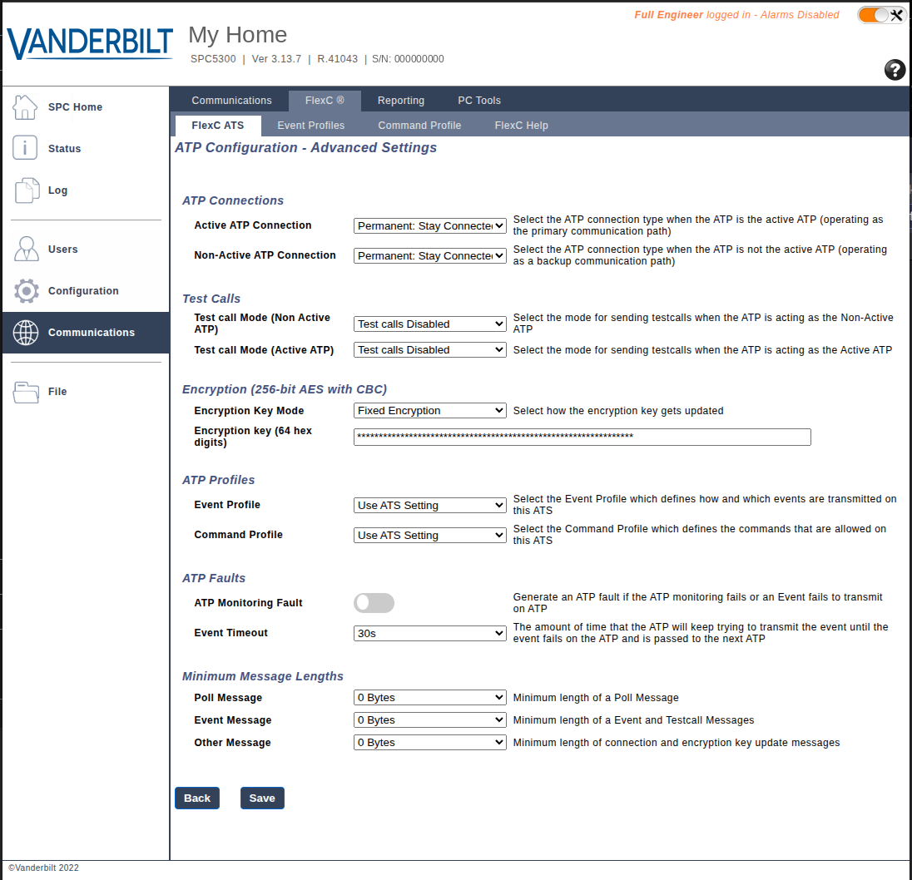
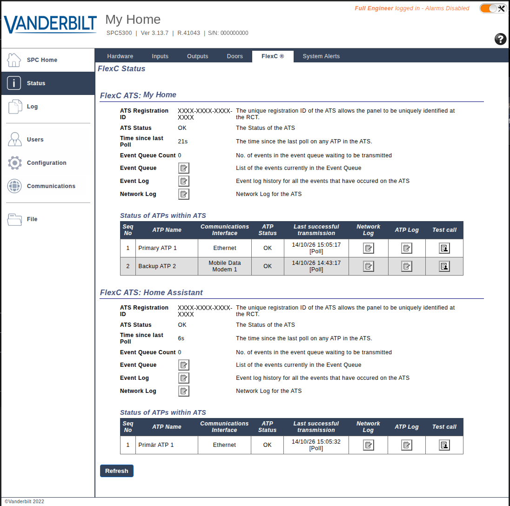

# Setting up the alarm panel

The panel connects to Home Assistant by itself over its FlexC protocol. You set up four things
in the panel's web interface:

1. a user the integration logs in as,
2. an event profile (which events are sent),
3. a receiver (a FlexC "ATS") pointing at Home Assistant,
4. the encryption key for the connection.

You need an engineer login to the panel's web interface. Do this on your local network.

> The panel does not send events while it is in engineer mode. Log out of engineer mode when you
> are done, before testing the integration.

## 1. Enter engineer mode

Log in to the panel's web interface with an engineer code and choose **Full Engineer** mode.

## 2. Create a user for Home Assistant

Add a new user, for example `homeassistant`, with the **Manager** user profile.

- Use letters, digits and common symbols; the panel tells you if something is not allowed.
- A double quote (`"`) cannot be used in the username or password.

The integration logs in with the user's **web password**, not the PIN. A new user has no web
password yet. To set one, log in to the web interface as that user with its PIN, then go to
**Configuration → Change Own PIN → Change Web Password**.

## 3. Add an event profile

Go to **Communications → FlexC → Event Profiles** and click **Add**.

- Name it, for example `Home Assistant`.
- Tick the report box for every event type. You can narrow this down later.

## 4. Add a receiver for Home Assistant

Go to **Communications → FlexC → FlexC ATS** and choose **Add Custom ATS**. Change these settings:

| Setting | Value |
|---|---|
| ATS Name | `Home Assistant` |
| Event Profile | the profile from step 3 |
| ATS Polling Timeout | 20 seconds |
| Generate FTC | off |
| Re-queue Events | off |

Then choose **Add ATP to FlexC RCT** and set:

| Setting | Value |
|---|---|
| SPT Account Code | a number, e.g. `999`; the same goes into the integration |
| RCT URL or IP Address | the IP address of your Home Assistant |
| ATP Category | Cat 6 (Ethernet) |
| RCT TCP port | `52000`, or the port you choose in the integration |
| RCT ID | a number, e.g. `1`; the same goes into the integration |

Save, and the new receiver shows up in the list next to any receivers the panel already has:

The SPT account code must not be `0`: the panel then connects but never starts polling. An
ATS created with **Import ATS** gets account code `0`, so set it again after importing.

Give Home Assistant its own ATS, rather than adding an extra ATP to an existing one. The ATPs
inside one ATS are backup paths to the same receiver.

## 5. Set the encryption key

Open **Advanced ATP Settings** and set:

| Setting | Value |
|---|---|
| Encryption Key Mode | Fixed Encryption |
| Encryption key | 64 hexadecimal characters (0–9, a–f) of your own choosing |

The integration needs the same key.

One way to make a random key on any computer with Python is
`python3 -c "import secrets; print(secrets.token_hex(32))"`.

## 6. Leave engineer mode and check the connection

Save and log out of engineer mode. Once the integration is set up in Home Assistant, the
receiver's status in the panel shows that it is connected. The integration also shows that the
panel is connected.

## Compatibility

| Panel | Firmware | Status |
|---|---|---|
| SPC5300 | 3.13.7 | tested |
| Other SPC4000/5000/6000 models | with FlexC | expected to work, not yet tested |

Please report other models and firmware versions in an issue.
